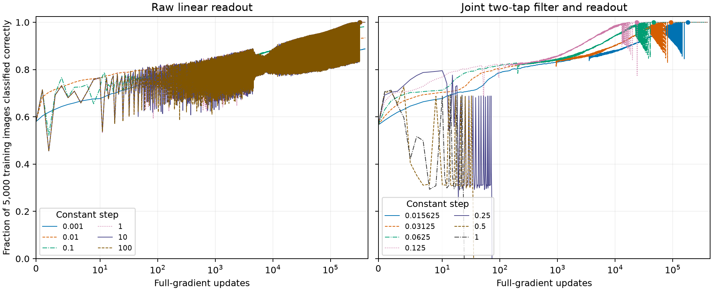

# First fit of joint two-tap gradient descent on many signed images

A circular two-tap convolution followed by a linear readout still represents a linear classifier. Training both layers changes which images drive the next update. On our shared draw of 5,000 CIFAR-10 airplanes and cars, most of the readout's progress along a separator measurable before training comes from the **change in the difference between the taps**. At larger brightness amplitudes the same separator remains available while the learned filter suppresses the stiff brightness response. The theorem bounds the time taken by ordinary simultaneous GD to reach strictly positive margin on every row in that regime. The native image comparison below uses separate trajectory certificates and matched step-size experiments. [Lean theorem and budget](BrightnessScaledTwoTapFirstFit.lean) · [Setup and oracle](../Setups/BrightnessScaledTwoTap.lean) · [GD and output](../Algorithms/BrightnessScaledTwoTap.lean)

## Problem and bound

Let $x_i$ be an image with its class sign absorbed, $e$ the constant unit vector, $S$ the circular shift by one flattened coordinate, $z_i=x_i-e\langle e,x_i\rangle$, and $x_i(R)=z_i+R e\langle e,x_i\rangle$. Define
$$
 A_i=(I-S)z_i/\sqrt2,\quad C_i=(I+S)z_i/\sqrt2,\quad d_i=\sqrt2\langle e,x_i\rangle .
$$
The mean logistic loss of the signed scores $m_i=\langle v,(a I+b S)x_i(R)\rangle$ is the objective. Each call at the current parameters returns the mean negative gradient in **all** parameters and a flag for $\min_i m_i>0$. Update both layers at the same constant step until the flag is true and retain the fitting parameters. A call costs one pass, or $n$ row contributions. Checking the terminal fit costs a pass. The chosen algorithm uses the public scalar bounds, initial readout and taps. It never receives a separating direction or the individual gradients.

Assume $\|A_i\|+\|C_i\|\le J$, $|d_i|\le D$, both $n^{-1}\sum_i(d_i)_+$ and $n^{-1}\sum_i(-d_i)_+$ are at least $\mu>0$, and some unit $u$ satisfies $\langle A_i,u\rangle\ge\gamma>0$ for every row. Two-sided brightness gives a restoring force when a large brightness coefficient misclassifies an entire sign group. Positive contrast margin ensures a classifier remains available after removing brightness. The upper bound allows zero brightness rows, arbitrary mixed products $\langle A_i,C_j\rangle$, and arbitrary initial readout. Dimension enters through these measurable quantities and the initial norm. The six cohorts below give interacting examples in dimensions 784 to 12,288. These conditions can exclude cohorts whose labels require brightness alone.

Let $P,Q$ denote the native sum and difference of the two taps divided by $\sqrt2$, with $Q\ne0$, and $v_0$ the native readout. Multiply both taps by $\sqrt R$, divide the centered readout by $\sqrt R$ and its brightness coordinate by $R\sqrt R$. This leaves every starting score equal to its value at $R=1$. It exploits the usual reciprocal layer rescaling of a homogeneous model. The scale is part of the initialization prescription and changes the law of GD away from $R=1$. Knowing $R$ and the scalar geometry bounds is part of the upper bound's information model. Computing a separator or searching for better constants is outside its pass count.

With $U=J(4+|P|+|Q|)$ and $\Gamma=\min(1,|Q|\gamma)/4$, use the single step $\eta=\kappa/R$ where $\kappa=\Gamma/[32(1+D)(1+U)]$. For every sufficiently large $R$, the [explicit budget](BrightnessScaledTwoTapFirstFit.lean) is **$O(1+\log R)$ full-gradient calls at fixed cohort, bounds and native initialization**. All inequalities specifying “sufficiently large” use public parameters only. Indeed $B,M,H,W=O(1+\log R)$ in the setup's formulas, $\epsilon$ and the single-step error allowance are $O((1+\log R)/R^2)$, and every left side in the three scale tests tends to zero while their right sides are bounded below. The row count is $n(H+1)$ for the displayed pass budget $H+1$. For example, using the native CIFAR seed, $n=5000$, $J=80.328$, $D=76.722$, $\mu=4.8795$ and $\gamma=0.0069439$, direct evaluation gives $\kappa\simeq 4.79\times10^{-10}$. The first passing integer power of ten is $R=10^{63}$, with $H\simeq1.17\times10^{57}$. The second scale test is the binding one there (left/right about 0.936). This is the sufficient proof regime for these conservative constants. The theorem gives neither a numerical prediction of 23,431 updates nor a native-scale guarantee by substituting $R=1$.

### Why the time is logarithmic

In scaled coordinates the centered readout is $w$, the tap sum and difference are $P_k,Q_k$, and the readout brightness is $T_k$. With votes $g_i=(1+\exp m_i)^{-1}$, let $F=n^{-1}\sum_i d_i g_i$, $A_g=n^{-1}\sum_i g_i A_i$, and likewise for $C_g$. The actual updates satisfy
$$
\begin{aligned}
 m_i&=R^2P_k T_k d_i+\langle w,Q_k A_i+P_k C_i\rangle,\\
 P_{k+1}&=P_k+\kappa F T_k+\kappa\langle w,C_g\rangle/R^2, &
 T_{k+1}&=T_k+\kappa F P_k,\\
 Q_{k+1}&=Q_k+\kappa\langle w,A_g\rangle/R^2, &
 w_{k+1}&=w+\kappa(Q_k A_g+P_k C_g).
\end{aligned}
$$
The votes include every row at every finite score. For $s=R^2P_k T_k$ the pointwise logistic inequality gives $sF+\mu |s|\le 1+U\|w\|$ within the proved envelope. Outside a small neighborhood of the brightness floor, steps with a sufficiently large $|F|$ contract $\max(|P_k^2-T_k^2|,\max(|P_k|,|T_k|)^2/4)$ up to a summable forcing allowance. Contraction from constant scale to inverse-polynomial scale costs at most $O(1+\log R)$ such steps. A long run could still consist mostly of small votes. Controlling it is where interactions between images and the changing anisotropy of the filter matter. [Exact coordinate updates](../Proofs/BrightnessScaledCoordinates.lean) · [Vote and work inequalities](../Proofs/BrightnessFirstFitForces.lean) · [Contraction and counting](../Proofs/BrightnessStiffPhase.lean)

On small-vote steps $P_k$ lies near the signed monotone reference $\sqrt{P_0^2\prod_{j<k}(1-\kappa^2F_j^2)}$, up to a fixed truncation near zero. Write $p$ for the truncated magnitude. For nonzero fixed difference tap $q$ one can transport the original contrast separator to a comparator $u_p$ for the whole filtered row. The cross-operator identity $\langle (I-S)x,(I+S)y\rangle=-\langle (I+S)x,(I-S)y\rangle$ holds even when mixed products between different rows are large. Resolving the separator using $q(I-S)-p\,\mathrm{sign}(P_0)(I+S)$, with the signs absorbed into the comparator, gives $\|u_p\|\le1$ and preserves margin $|q|\gamma$. Most importantly, for $p\ge r>0$,
$$
(p+r)\|u_p-u_r\|^2=(p-r)(\|u_r\|^2-\|u_p\|^2).
$$
Cauchy–Schwarz and telescoping bound the total comparator travel by $\sqrt{\log(p_{\rm start}/p_{\rm end})}$, independently of dimension and the number of changes. A nonfitting iterate spends at least $1/(2n)$ in average vote. Tracking the readout distance to the scaled comparator charges every small-vote nonfitting step for progress, even across the intervening contracting steps. At the floor, a fixed contrast comparator and the dominant squared brightness coordinate give a decreasing energy. The two bounds force a fit within $H$ updates from the prescribed start. [Transport identity](../Proofs/BrightnessFilterTransport.lean) · [Prefix bound](../Proofs/BrightnessPrefixLength.lean) · [Terminal bound](../Proofs/BrightnessTerminalLength.lean) · [First fit under execution](../Proofs/BrightnessFirstFitExecution.lean)

## Which comparison improves

Tyurin's Figure 1 compares raw and bilinear logistic GD. Section 5 analyzes two-example perceptron dynamics. PR #253 treats finite-step logistic GD on a specific two-example defect with a small random initialization and a confidence parameter. The result here treats an arbitrary finite cohort, a deterministic supplied initialization and the smooth logistic votes throughout. Its contrast, separability and initialization hypotheses differ from the defect construction (a constant example has zero contrast), so the earlier two-sample theorem remains a separate case. PR #281 gives an all-step rare-group obstruction on a selected 2,041-image set, where plain GD needs at least 254 updates and joint GD fits in 41. Varying group multiplicities gives a different obstruction from changing brightness on the entire fixed cohort. [Tyurin, ICML 2026, Figure 1 and §5](https://proceedings.mlr.press/v306/tyurin26a.html) · [PR #253](https://github.com/k3nfalt/longtails/pull/253) · [PR #281 with experiments and contribution notes](https://github.com/k3nfalt/longtails/pull/281)

PR #282 proves $O(R)$ for joint GD with a fixed native tap scale under a small cross-row mixed-product condition, a cone and norm-balance requirement on initialization, and a lower bound on nonzero brightness. Its note explicitly identifies the cost of changing comparators as an obstacle on native CIFAR. The new transport bound and the reciprocal initialization together give $O(\log R)$ and remove those three restrictions. The two bounds concern different physical initializations for $R>1$. PR #282 also proves that for raw score-matched logistic GD, **every positive constant step** requires $\Omega(R^2/\log R)$ on fixed cohorts with a negative initial score on a brightness-balanced convex pair, bounded residuals, separated nonzero brightness and lattice clearance of the opening brightness vote. On their intersection this gives a separation of order at least $R^2/(\log R)^2$ in passes. Quantized inputs alone do not ensure clearance or an initial deficit. The explicit large-$R$ cutoff for the lower bound can be very large. [PR #282 including both theorem notes](https://github.com/k3nfalt/longtails/pull/282)

The same fixed-linear obstruction applies to GD on the **full initial tangent model** on the checked family with $P_0\ne0$. In the linearization use a readout coordinate parallel to $e$ and the other coordinates perpendicular to it, with two additional columns for tap derivatives. Divide the whole Jacobian by $\sqrt R$ and absorb the common factor into the arbitrary positive step. Its brightness coordinate is then $\sqrt2 P_0 R\langle e,x_i\rangle$; the centered filtered rows are fixed, and the extra two columns are $O(1/R)$ because of the inverse-scaled initial readout and its compensated brightness coordinate. Initialize the centered linear weights at the native centered readout, its brightness weight at $\langle e,v_0\rangle/R$, and the two new weights at zero. This reproduces every native initial score. Thus the residual bounds in #282 can be chosen uniformly, even though the extra coordinates vary with $R$. The signed brightness lattice and opening clearance scale by $|\sqrt2P_0|$ when brightness is expressed in the native $\langle e,x_i\rangle$ convention. For CIFAR the two group integer totals are 243827210 and 625563862, of gcd 22. Rows 1763 and 4621 have brightness sums 102 and −32 and a brightness-balanced initial score below −0.04329. The certified opening distances exceed $7.60\times10^{-8}$ for raw and $5.17\times10^{-9}$ for the full tangent. These applications of #282 are mathematical comparisons accompanying the one new formal upper theorem. [Opening and balanced-pair calculation](../Experiments/BrightnessScaledTwoTapFirstFit/opening_clearance.py)

A standard smooth convex logistic loss bound gives a different upper bound. Average loss below $\log(2)/n$ suffices for first fit, and the raw brightness curvature can be order $R^2$. The large-step risk analysis of Wu et al. does not give a lower bound on first fit or apply to this coupled bilinear update. A preselected zero-sum filter eliminates brightness immediately and makes the residual linear GD problem independent of $R$; a known contrast separator would itself solve the classification task. This is a GD parameterization result, with no claim of optimality among algorithms or filter choices. Prior work proves accelerated optimization through depth, asymptotic convolutional representation costs, and kernel versus feature-learning regimes. Those results do not supply a cold finite first-strict-fit time for two trained taps and a general fixed image cohort. Related PRs demonstrate synthetic ranking/multiplicity separations, local trajectory analyses or full-data computer-assisted bounds. The native comparison below builds on their reproduction and previous trajectory work. [Wu et al., COLT 2024](https://proceedings.mlr.press/v247/wu24b.html) · [Arora et al., ICML 2018](https://proceedings.mlr.press/v80/arora18a.html) · [Jagadeesan et al., COLT 2022, Lemma 18](https://proceedings.mlr.press/v178/jagadeesan22a.html) · [PR #258](https://github.com/k3nfalt/longtails/pull/258) · [PR #279](https://github.com/k3nfalt/longtails/pull/279) · [PR #280](https://github.com/k3nfalt/longtails/pull/280)

## Figure 1 and native first fit



We used 2,500 airplanes and 2,500 cars drawn without replacement from the CIFAR-10 training set, seed 20261125, shared by all models and rate choices. The ordered indices are included. Tyurin gives the sample size and classes but supplies no identifying seed or index list in the paper or its supplement. This reproduces the design on the public PR #281/#282 draw; the identity of the author's draw remains unknown. Images have channel-major flattening, one circular shift across the flattened vector, pixel range $[-1,1]$, no bias and no augmentation. Uniform initial draws are shared across trials. The paper-style raw comparison uses the original readout with identity filter. A separate raw control matches the joint starting scores.

| FP32 sweep | Raw first-fit update | Joint first-fit update | Raw passes across the search | Joint passes across the search |
|---|---:|---:|---:|---:|
| Figure 1 rates, six raw and seven joint | 319,077 | 23,676 | 2,171,274 | 1,544,864 |
| Same 35 half-power rates per model | 292,117 | 18,539 | 12,716,170 | 11,189,300 |

The search columns stop each candidate at detection or at update 400,000 and charge its terminal check. The plot continues each run through the cap. All 5,200,013 plotted-grid counts and 28,000,070 matched-grid counts agree exactly with the archived public replay. One run hitting at update $t$ uses $t+1$ passes. Floating-point arithmetic, matrix order, precision, and batching rates together can move a first hit, which motivates the real-arithmetic checks below. [Grids, digests and first hits](../Experiments/BrightnessScaledTwoTapFirstFit/expected.json) · [Ordered indices](../Experiments/BrightnessScaledTwoTapFirstFit/indices.npy)

For an FP64 comparison, give every model the same 47 positive constant steps $2^{j/2}$, $-20\le j\le26$, and count only finite, strictly fitting states. Cold joint GD first fits at **18,868** updates. Raw GD takes 291,999 with the original initialization or 293,730 with matched initial logits. Freezing the initial filter gives 29,990. Training the full initial Jacobian as an affine model, including **both** tap columns, gives 31,273. A fixed difference filter with a score-matching initial offset takes only 7,254. Filtering alone thus explains a large part of the raw-to-joint gain. Whether a learned filter beats a fixed one depends on which filter is fixed. These counts concern finite grids. The original raw cap is higher to observe its first fit; truncating every run at the smaller horizon preserves the joint hit while censoring every raw trial. For example, running all 47 original-raw candidates to fit or the 400,001-call cap costs 16,576,463 passes. The full joint search to fit or 80,000 calls costs 3,548,417. All candidate outcomes and horizons are supplied so other search policies can be charged explicitly. [Sweeps](../Experiments/BrightnessScaledTwoTapFirstFit/sweep_results.json)

**Which part of joint training matters at native scale?** Before fitting, compute a unit separator $u_A$ for the signed difference images $A_i$. A primal margin of 0.006943988 and a simplex-dual upper bound of 0.006944024 locate the optimum. By contrast, 1,287 signed rows have negative projection on the mean difference image. The mean direction has cosine about 0.0735 with $u_A$. Any positive logistic votes satisfy $\langle u_A,A_g\rangle\ge\gamma\sum_i g_i/n$. As the taps change, the contrast contribution to the update is $\eta Q_k A_g$. Both the current vote and the learned tap matter.

The following native endpoint result uses the real simultaneous update at $\eta=1/8$. The first strict fit is update **23,431**. From the prescribed initialization the centered readout gains 13.86540 along $u_A$. Summing the actual updates gives 0.59112 from the initial difference tap, **12.85996 from the change in that tap** (92.75% of net progress), and 0.41432 from the full smooth tap. Each contribution has certified error below 0.0002. The tap sum grows from 0.0481 to 1.4233 and the difference from 0.2369 to 16.573. An independently tuned fixed model can obtain a comparable scalar contrast step: at this endpoint $\eta Q_k^2\simeq34.3$, versus $512 Q_0^2\simeq28.7$ for the best frozen tangent rate. Relative weighting and readout alignment change as well.

At those same terminal parameters remove only
$$
 (Q_k-Q_0)\langle w_k-w_0,u_A\rangle\,\langle A_i,u_A\rangle .
$$
Every row loses at least 1.57285 in signed margin, exactly 236 become negative and the worst margin becomes −15.0679. Evaluating just the initial tangent at this displacement misses 1,782 rows; restoring this one channel still misses 189. Removing a term at the endpoint tests an algebraic contribution. To test the *trajectory*, remove exactly that bilinear term from the model, retain its entire initial score and Jacobian, retrain every parameter from the same start and repeat the 47-rate search. The earliest empirical fit moves from 18,868 to **69,393**, 3.68 times as many updates. Removing a fixed random direction instead gives 18,415 and removing the mean-image direction gives 27,793. Keeping the contrast bilinear term with the entire tangent while removing the other two bilinear terms gives 12,112. Keeping smooth, brightness or both without the contrast term yields no fit within 75,000 checked states at any tested rate. GD gets no separator in the full run. The intervention uses it only to measure which learned component the original trajectory exploits. [Intervention code](../Experiments/BrightnessScaledTwoTapFirstFit/native_grid.py) · [Certified channel calculation](../Experiments/BrightnessScaledTwoTapFirstFit/Certificates/native_channel.py)

Real-arithmetic comparison uses one common grid consisting of the 12 distinct Figure 1 steps together with $\sqrt8$, $\sqrt2/8$ and 512. These additions include the empirical native winning steps for raw, joint and tangent. Every original-initialization raw run on this grid takes **at least 24,912 detection calls**; every full initial tangent run takes **at least 28,674**. At $\eta=\sqrt2/8$ the real joint trajectory first fits at update **18,379**, or **18,380 detection calls**. Thus the certified first-fit ratios on this common grid are at least 1.35 for original raw and 1.55 for the score-matched tangent (before rounding, 24,912/18,380 and 28,674/18,380). The bounds apply even if each baseline receives its own optimal step on this grid. The tangent is also certified nonfitting continuously on $[0,6]$ through update 28,687. These native results leave intermediate untested step sizes outside that interval open. At the winning joint rate, every earlier state has a row of margin at most $-2.371\times10^{-6}$, and the first fitting state has minimum margin greater than 0.00027412. Removing the same contrast channel costs at least 1.63872 on every row and turns 231 margins negative. Learned contrast supplies 14.60569 of 15.56950 in readout alignment here. The floating-point and real-arithmetic times differ by 489 updates at that step. The certificates use fixed-point reference states, interval sigmoid evaluations and error transport to enclose real iterates. The native raw grid incorporates the earlier 12-rate certificate from PR #280. The numerical certificates are independently checkable auxiliary evidence outside the abstract Lean proof. [Earlier native proof work](https://github.com/k3nfalt/longtails/pull/280) · [Certificate sources](../Experiments/BrightnessScaledTwoTapFirstFit/Certificates)

## Transfer and brightness experiments

Each row below uses its own signed training cohort, native taps and readout. Margin intervals come from pretraining primal and dual witnesses. Columns on the right use independent tuning over the same 47 steps for actual joint GD, the full tangent, and GD with the rank-one contrast interaction removed. Times are first-fit updates, not search totals.

| Cohort | Rows × dimensions | Contrast margin | Joint | Tangent | Remove learned contrast along $u_A$ |
|---|---:|---:|---:|---:|---:|
| CIFAR-10 airplane/car | 5,000 × 3,072 | 0.006944 | 18,868 | 31,273 | 69,393 |
| EuroSAT classes 3/7 | 5,000 × 12,288 | 0.028575 | 6,106 | 7,652 | 24,502 |
| Fashion-MNIST 5/7 | 2,000 × 784 | 0.075591 | 3,298 | 111 | 6,616 |
| Fashion-MNIST 7/9 | 2,000 × 784 | 0.082887 | 3,789 | 242 | 5,885 |
| Gisette | 6,000 × 5,000 | 0.80995 | 967 | 2,777 | 4,680 |
| MNIST 7/8 | 12,116 × 784 | 0.040207 | 30,111 | 15,073 | 38,507 |

Deleting this component slows joint GD on all six cohorts, while the tangent wins on both Fashion pairs and MNIST. A positive contrast margin predicts the availability of the channel; by itself it does not rank algorithms across datasets. On CIFAR, $J=80.328$, $D=76.722$ and $\mu=4.8795$ are feasible rounded geometry parameters. The archived per-cohort values can be recomputed from signed images before training. [Geometry checks](../Experiments/BrightnessScaledTwoTapFirstFit/geometry.py) · [Full per-rate results](../Experiments/BrightnessScaledTwoTapFirstFit/sweep_results.json)

The analysis and the native intervention both use the contrast separator, but their dynamics differ. At native scale the changing difference tap contributes most of the measured alignment. At large $R$ the proof keeps $Q_k$ near $Q_0$ and controls the brightness excursion. To distinguish these experimentally, vary brightness while preserving every initial logit. One sweep uses a contrast-covariance calibration $B^2=1+(R-1)/(\kappa_0 Q_0^2\lambda_A/4)$, with $\lambda_A=\lambda_{\max}(A^\top A/n)$ and $\kappa_0=0.057369485$ on CIFAR. Training uses seven common $\kappa$ values with physical step $\kappa/R$. At $R=1$, contrast-only nonlinear restoration fits in 12,171, while brightness-only restoration is censored at 750,000. At $R=2^{20}$, brightness-only restoration fits in 193,650, the full model in 306,697, and contrast-only restoration is censored. The calibrated full model also reaches fit at all 12 tested scales on each of the six cohorts in a separate single-step-per-cohort sweep. For the theorem's exact $B^2=R$ gauge a less conservative experimental step takes 50,889 updates at $R=1$, and several scales reach the 1.6-million cap. These finite sweeps distinguish the roles of the two channels. Their covariance calibration and practical steps differ from the theorem's explicit constants. [Crossover experiments](../Experiments/BrightnessScaledTwoTapFirstFit/crossover.py) · [Scale sweep](../Experiments/BrightnessScaledTwoTapFirstFit/sqrtgauge.py)

## Reproduction

Run the following from the [experiment directory](../Experiments/BrightnessScaledTwoTapFirstFit). The plotted runs use NumPy, PyTorch with CUDA, PyArrow, Pillow and Matplotlib. The scale sweep also uses SciPy. The archive for the two FP32 sweeps is the pinned CIFAR training Parquet, SHA-256 `8428b53a88a11ac374111006708df51469e315a22ac6d66470afd9c78d2ae883`. The replay verifies the integer counts over the entire trajectory as well as the ordered indices. [Pinned training file](https://huggingface.co/datasets/uoft-cs/cifar10/resolve/0b2714987fa478483af9968de7c934580d0bb9a2/plain_text/train-00000-of-00001.parquet)

```sh
python reproduce.py cifar train-00000-of-00001.parquet rerun-paper --grid paper
python reproduce.py cifar train-00000-of-00001.parquet rerun-matched --grid matched
python verify_figure.py
python plot.py
```

The FP64 and certificate replays read an ordered signed cohort reconstructed from SHA-256 row fingerprints and the archived dyadic initialization. The fingerprint manifest and row loader use PR #282's released draws. Supply the same pinned CIFAR Parquet or the Toronto CIFAR-10 **binary** archive, EuroSAT RGB JPEG zip, UCI Gisette zip, or the matching train-images and train-labels IDX gzip pair in a directory. The aliases are `cifar`, `euro`, `gisette`, `fashion57n2000`, `fashion79n2000` and `mnist78`. Give the output the cohort's basename so the margin checker can find its witness. The table reports the minimum over all positive hits on each independent common grid. In the results archive $-1$ denotes censoring. [CIFAR-10](https://www.cs.toronto.edu/~kriz/cifar.html) · [EuroSAT](https://github.com/phelber/EuroSAT) · [Gisette](https://archive.ics.uci.edu/dataset/170/gisette) · [Fashion-MNIST](https://github.com/zalandoresearch/fashion-mnist) · [MNIST](https://storage.googleapis.com/cvdf-datasets/mnist/train-images-idx3-ubyte.gz)

```sh
python prepare.py cifar train-00000-of-00001.parquet cifar.npz
python geometry.py cifar.npz
python opening_clearance.py cifar.npz
python native_grid.py cifar.npz abc 80000 joint.npz
python native_grid.py cifar.npz tangent 80000 tangent.npz
python native_grid.py cifar.npz raw-original 400001 raw.npz
python native_grid.py cifar.npz raw 400001 score-matched-raw.npz
python native_grid.py cifar.npz remove-svm 75000 deleted.npz
python sqrtgauge.py cifar.npz 1600000 native theorem-gauge.npz
python sqrtgauge.py cifar.npz 4000000 calibrated calibrated.npz
python crossover.py cifar.npz abc 750000 crossover.npz
```

For the native interventions, `a` enables the contrast–readout bilinear product, `b` the brightness product, and `c` the smooth–readout product. All retain the initial affine model. Use `a`, `b`, `c`, `ac`, `ba`, `bc`, `abc`, or the named fixed and deletion controls in `native_grid.py --help`. The crossover accepts the same three letters. Floating-point reimplementations can produce different first hits even at identical nominal precision. For example, an independent matrix ordering for the tangent at its best rate gives 31,518 rather than 31,273.

### Auditing the native real-arithmetic comparison

Run the following from the experiment directory’s `Certificates` subdirectory. DATA is the absolute path to the prepared `cifar.npz`. Supply one NumPy archive with signed pixel integers in `signed_pixels` (or `levels` and `codes`) and binary64 arrays `v0`, `c0` containing the native initialization. The reader verifies the ordered signed-integer rows and the dyadic tap and readout numerators by SHA-256. The signed row matrix has digest `d7d5c570ffaa32039f6d85a04fa701e3eb1dd3d833a4b1ef32650b7a6ce5033c` as little-endian int16 in C order. The exact image features are these integers divided by 255. The tap and readout denominator exponents are 24 and 30. The included contrast direction is the binary64 pretraining separator used by the intervention (little-endian binary64 raw-array SHA-256 `4189fe2c9cc001cef43169ca54aa6a2fed83a43c3fd0a2e851254ec02f03c5e3`). The raw continuation witness is a nonnegative integer vector from the earlier matched-draw investigation (little-endian int64 raw-array SHA-256 `67d876f4269667b05c0aaf998f14483176799160a63c5225597aac01ed61158a`). Verification of its support function is exact and independent of how it was found.

Use Python with NumPy, PyTorch CUDA binary64 and an LP64 C++ compiler with OpenMP, GMP, MPFR and FLINT 3.x including Arb. Runs used an NVIDIA H100. Each WORK name denotes a separate scratch directory. The tangent and raw references require about 1–3 GB each. Each joint reference needs about 4 GB. Reference construction and numerical validation are additional computational work. They are separate from the optimizer's full-batch calls. Compile in the directory containing the sources and replace DATA with the archive path.

```sh
c++ -O3 -fPIC -shared -fopenmp native_reference.cpp -o native_reference.so -lflint -lmpfr -lgmp
c++ -O3 -fPIC -shared -fopenmp joint_reference.cpp -o joint_reference.so -lmpfr -lgmp
python native_low_rates.py DATA
python native_continuous.py DATA intervals.json
python native_reference.py DATA tangent WORK_T100 4608 100 28672 6
python native_transport.py DATA tangent WORK_T100 100 28672
python native_reference.py DATA tangent WORK_T512 8192 512 28672 6
python native_transport.py DATA tangent WORK_T512 512 28672
python native_reference.py DATA raw WORK_R512 20480 512 15360 8
python native_transport.py DATA raw WORK_R512 512 15360
python native_raw_tail.py DATA WORK_R512
python native_reference.py DATA raw WORK_RSQ8 12288 sqrt8 15360 8
python native_transport.py DATA raw WORK_RSQ8 sqrt8 15360
python native_raw_tail.py DATA WORK_RSQ8 sqrt8
python native_reference.py DATA raw WORK_REIGHTH 1536 sqrt2over8 15360 6
python native_transport.py DATA raw WORK_REIGHTH sqrt2over8 15360
python native_raw_tail.py DATA WORK_REIGHTH sqrt2over8
python joint_reference.py DATA WORK_JOINT
python joint_transport.py DATA WORK_JOINT
python native_channel.py DATA WORK_JOINT
python joint_reference.py DATA WORK_JBEST sqrt2over8
python joint_transport.py DATA WORK_JBEST sqrt2over8
python native_channel.py DATA WORK_JBEST
python native_hard_limit.py DATA raw
python native_hard_limit.py DATA tangent
```

The frozen tangent augments the initial filter response with both tap derivatives and preserves the exact initial nonlinear scores. The tangent and raw references store effective predictors on dyadic grids and multiply 26-bit limbs by signed pixel integers exactly. They enclose logistic votes using Arb and compute the metric and state updates using GMP. For an irrational rate, the integer square root computes the lower dyadic endpoint with error below one initial precision unit. The precision pilot only selects arithmetic precision. It supplies no mathematical error bound. Restart an interrupted raw or tangent reference with the same command and scratch directory. The independent transport checks every saved reference vote through the target horizon, bounds errors in 64-step secant products and proves nonfit by a norm bootstrap. With a raw tail certificate, the weighted signed score at the protected endpoint and the exact maximum gain per update give the last excluded update. The strict fits use one more call for detection. Low-rate rows marked True are certified. The program also reports unverified trial rates.

For the full tangent, the continuous-rate script verifies that the largest eigenvalue of the tangent-feature covariance is below 4/3 using a Cholesky factor and a residual bound. The Hessian of the convex logistic objective is bounded by one quarter of this covariance. Every exact step is nonexpansive for η in [0,6]. Relative to a center rate, a nearby rate increases the parameter uncertainty by at most their absolute difference times the current gradient norm, plus arithmetic error. For each center the script tracks these sums and a negative-row margin divided by its row norm. The 169 certified neighborhoods cover [0,6] through update 28,687 inclusive.

The joint reference advances both taps and the readout from the same old state. The joint transport uses per-block controllability Gramians for linearized impulse responses and a Hessian Lipschitz remainder, with a bootstrap for nonlinear errors. Its 1/8 implementation reproduces the archived 131-block proof of the 23,431 first hit. Each endpoint channel check recomputes all scores exactly at the stored binary64 state and allows 10⁻⁸ for exporting and transporting parameters. If the state norm is below 64 and the transported discrepancy below 10⁻¹⁴, the total error is less than 10⁻⁸ by Cauchy–Schwarz on the full score and the rank-one deleted term. The script also projects and sums the actual readout updates on the supplied pretraining unit direction. Each centered or smooth row has norm below 79. The vote projection errors from row products, normalization, vote storage and summation are below 10⁻⁹. This gives cumulative absolute error below 0.001 per term at either step, and below 0.0002 for 1/8 using the verified norm bound 25.5.

The hard-limit check excludes all sufficiently large steps by induction. For a hard-trajectory clearance δ through T and maximum feature norm r, it suffices that r‖θ₀‖/η+Tr²exp(−ηδ/2)≤δ/2. The opening uses the actual nonzero native initialization. Use r=56 for raw, r=5 for the tangent and T=24,576. The checked clearances exceed 3.8·10⁻⁸ and 9.9·10⁻¹³, respectively. These are coarse tails beyond the plotting rates.
