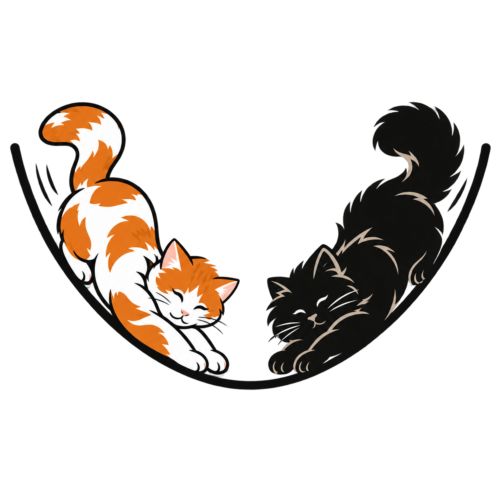

<h1 align="center"> </h1>

<h3 align="center">Discovering new results in mathematical optimization.<br>
More than 25 new results so far—and more to come.</h3>

<p align="center"><a href="https://k3nfalt.github.io/longtails/"><strong>Explore the results on our website →</strong></a></p>

## Preliminaries: Setup and Complexity

LongTails is a framework for **automatic research in mathematical optimization**.
Before presenting it, let's explain a typical protocol in optimization using the following example. We want to minimize
```math
\min_{x\in ℝ^d} f(x).
```
**Setup.** The function $f$ is differentiable, convex, and $L$-smooth, and we can
query an exact gradient oracle. Starting from $x_0$, we want an output
$x_{\mathrm{out}}$ satisfying $f(x_{\mathrm{out}})-f(x^\star)\le\varepsilon$.

**Complexity.** A classical accelerated gradient method achieves this accuracy using
```math
\textbf{Complexity} = O\left(\sqrt{\frac{LR^2}{\varepsilon}}\right).
```
gradient queries. Here $L>0$, $\varepsilon>0$, and $R\ge0$ bounds the initial distance to a minimizer:
$\lVert x_0-x^\star\rVert\le R$.

Similarly, one can consider other **Setups** with different assumptions, oracles, and accuracy criteria, such as nonconvex optimization, stochastic gradients, monotone operators, and linear minimization oracles (LMOs).

**Ultimate goal:** Given a **Setup**, we want to design a method and prove that it achieves the best possible **Complexity**.

## What is LongTails?

**LongTails** is a Lean 4 framework built for this goal. You choose a **Setup**, and our *framework guarantees* that the proved **Complexity** is correct: no extra assumptions, no uncounted oracle calls, no gaps in the proof.

Here is how this works for the example above. A summary is presented on our [website](https://k3nfalt.github.io/longtails/#SmoothAndConvex). Its **Setup** is defined in
[SmoothAndConvex.lean](LongTails/Setups/SmoothAndConvex.lean).
It might look intimidating if you're new to Lean 4 or LongTails, but we'll show you how simple it is.

```lean4
abbrev spec : Setup where
  Params := Params
  Public := Public
  Instance p := p.E → ℝ
  Query p := p.E
  Reply p := p.E
  Output p := p.E
  publicInput := Params.toPublic
  valid q := 0 < q.L ∧ 0 ≤ q.R ∧ 0 < q.ε
  admissible q f oracle :=
    ConvexOn ℝ Set.univ f ∧
    (∀ k seed x, HasGradientAt f (oracle.answer k (0, x) seed) x) ∧
    (∀ k seed x y, ‖oracle.answer k (0, x) seed - oracle.answer k (0, y) seed‖ ≤ q.L * ‖x - y‖) ∧
    (∃ xstar, IsMinOn f Set.univ xstar ∧ ‖q.x0 - xstar‖ ≤ q.R)
  successful q f output P :=
    ∃ xstar, IsMinOn f Set.univ xstar ∧
      ∀ᵐ ω ∂(P : MeasureTheory.Measure _), f (output ω) - f xstar ≤ q.ε
```

1. The first few lines, from `Params` to `Output`, define the types: the objective $f$ maps points in $E$ to real numbers, while oracle queries, gradient replies, and the method's output are all points in $E$.
2. `valid` gives the allowed parameter values: $L>0$, $R\ge0$, and $\varepsilon>0$.
3. `admissible` states the assumptions: $f$ is convex, the oracle returns its exact gradient, the gradient is $L$-Lipschitz, and a minimizer lies within distance $R$ of $x_0$.
4. `successful` defines the target: the output's function value must be within $\varepsilon$ of the minimum. The notation `∀ᵐ ω ∂P` means this must hold almost surely.

In practice, you ask an agent such as Codex or Claude Code to formalize your **Setup** in LongTails, check that it captures your intended problem, and **that's it!** Leave the remaining Lean 4 work to agents searching for better **Complexities**.

For [SmoothAndConvex.lean](LongTails/Setups/SmoothAndConvex.lean), the **Complexity** (aka budget) and convergence theorem in [AcceleratedConvex.lean](LongTails/Theorems/AcceleratedConvex.lean) are:

```lean4
noncomputable def budget : (let S := spec; S.Params → Fin S.numOracles → ℕ) := fun q _ =>
  max 1 ⌈Real.sqrt (2 * q.L * q.R ^ 2 / q.ε)⌉₊

theorem result : Convergence spec budget ...
```

**The key point:** the framework uses [Comparator](https://github.com/leanprover/comparator) to independently audit the theorem and its **Complexity** bound, `max 1 ⌈Real.sqrt (2 * q.L * q.R ^ 2 / q.ε)⌉₊`, against the specified **Setup**. Agents searching for a method and its proof cannot pass this check by adding assumptions, skipping oracle calls in the count, or leaving gaps in the proof.

## Our Achievements

Using LongTails, we have already discovered **more than 25 new complexity bounds** across different areas of optimization, covering both existing and new setups.

**One example: $(L_0,L_1)$-smooth optimization.** Assume that $\lVert\nabla^2 f(x)\rVert\le L_0+L_1\lVert\nabla f(x)\rVert$ (a recent popular assumption in optimization). We establish a new accelerated, gradient-only guarantee for convex functions, with improved dependence on $L_1$ and the initial distance bound $R$. For simplicity, we hide logarithmic factors using $\widetilde O$ notation.

**Previous bounds:** [Tyurin, Theorem 4.3](https://arxiv.org/html/2508.06884v2) and [Vankov et al., Theorem 6.2](https://arxiv.org/html/2410.10800v3).

```math
\widetilde O\!\left(\sqrt{\frac{L_0R^2}{\varepsilon}}+L_1R\right)
\qquad
\widetilde O\!\left((1+\nu)\left[\sqrt{\frac{L_0R^2}{\varepsilon}}+(L_1R)^{2/3}\right]\right)
```

Tyurin's bound counts gradient queries and is specialized to the same initial distance and objective-gap bounds. Vankov et al.'s bound includes function and gradient queries used by the exact line search. Here $\nu$ is the oracle cost of an exact one-dimensional minimization; their analysis does not bound this cost in the setup parameters.

**Our new bound** ([Lean theorem](LongTails/Theorems/GeneralizedSelfNormalizedConvex.lean)), using only gradient queries:

```math
\widetilde O\!\left(\sqrt{\frac{L_0R^2}{\varepsilon}}+(L_1R)^{2/3}\right).
```

Ignoring logarithmic factors, we improve Tyurin's **$L_1R$ term to $(L_1R)^{2/3}$** and remove Vankov et al.'s **$(1+\nu)$ factor**.
Achieving this complexity using only gradient queries was an open problem.

A summary of this setup and its complexity bounds is presented on our [website](https://k3nfalt.github.io/longtails/#GeneralizedSmoothAndConvex).

Explore more [setups](LongTails/Setups/) and [complexity bounds](LongTails/Theorems/) in the repository and on our [website](https://k3nfalt.github.io/longtails/).

## How to Use It?

**Install the prerequisites.** Install Elan and Python 3 ([REQUIREMENTS.md](REQUIREMENTS.md)). Clone the repository. Run `./build.sh` from its root (It downloads the Mathlib cache, plus roughly 30 minutes to an hour for the full build). For local use, it is sufficient to build just the theorem you need: `./build.sh LongTails.Theorems.YourTheorem`. This is much faster, about 2–3 minutes for the tutorial theorem after the cache download.

**Choose a setup and start researching.** Explore the existing [setups](LongTails/Setups/) or ask an agent to formalize a new **Setup**. Check that its assumptions, oracle model, and accuracy criterion match your intended problem, then ask your agent to design a method and prove a new **Complexity** bound. Finally, run `python3 run_comparator.py YourTheorem.lean` to independently audit the theorem and its **Complexity** bound against the **Setup**.

## Contribute

You're welcome to use our framework to check your ideas locally. If you'd like to contribute your results, please follow the steps below.

If you add or remove Lean modules, run `lake exe mk_all --lib LongTails` to update the import index. Then run `./lint.sh` to check formatting, build the code, and run the linters. Once lint and the Comparator audit both pass, open a pull request explaining the setup, bound, and contribution.

## Tutorial

Let's walk through the full workflow using a classical example: nonconvex optimization with $L$-smooth functions and stochastic gradients. We've kept this example separate from the main library so that we can add it during the tutorial.

**[Setup](tutorial/ToBeDiscovered/Setups/StochasticSmoothNonconvex.lean).** The function $f$ has an $L$-Lipschitz gradient and satisfies $f(x_0)-f^{\star}\le\Delta$, where $f^{\star}$ is a global lower bound. We have access to unbiased stochastic gradients with variance at most $\sigma^2$, generated from IID samples. Our target is $\mathbb{E}[\lVert\nabla f(x_{\mathrm{out}})\rVert^2]\le\varepsilon^2$.

We will prove the classical **Complexity** bound of

```math
K = 1 + \left\lceil\frac{4L\Delta}{\varepsilon^2}+\frac{8L\Delta\sigma^2}{\varepsilon^4}\right\rceil
```

1. **Add the setup and theorem.** Ask an agent to formalize the **Setup** above, define constant-step SGD, and prove that it achieves the stated **Complexity**. A starting prompt is:

   > Follow AGENTS.md. Formalize the stochastic nonconvex setup described above in LongTails, then prove the stated oracle complexity for constant-step SGD with a uniformly random pre-update iterate as output. Put the algorithm and supporting lemmas in their respective folders, and export `result : Convergence spec budget` with the explicit budget. Count every oracle call and use no `sorry` or additional axioms.

   For this tutorial, we can simulate the agent's output by copying a prepared solution:
   ```sh
   python3 tutorial/fake_run_research_script.py
   ```

   The script copies the example into `LongTails/`.

2. **Inspect the files.** Under `LongTails/`, you will find `Setups/StochasticSmoothNonconvex.lean` with the assumptions and accuracy criterion, `Algorithms/RandomSgd.lean` with the algorithm and its output, and `Theorems/SgdNonconvex.lean` with the explicit budget and convergence theorem. Supporting lemmas live in `Proofs/`.

3. **Verify the complexity.** Run these commands from the repository root:
   ```sh
   ./build.sh LongTails.Theorems.SgdNonconvex
   python3 run_comparator.py SgdNonconvex.lean
   ```
   If the build and audit pass, the **Complexity** bound is verified against the formal **Setup**. The audit ends with this message, shown in green in the terminal: "Checked 1 convergence results and their budgets. The solutions are okay!"

4. **View the setup locally (optional).** Install the [server requirements](server/README.md), then run:

   ```sh
   python3 -m server.build
   python3 server/serve.py
   ```

   Open <http://127.0.0.1:8000/> and find **StochasticSmoothNonconvex** to inspect its Lean source and **Complexity** bound. The build does not run Codex; descriptions and references appear only if they have already been generated.

Once you're done experimenting, you can remove the copied files with `git clean -f -- LongTails/`, provided you haven't staged or committed them. Preview the list first with `git clean -n -- LongTails/`: this also removes any other untracked files under `LongTails/`. If you updated `LongTails.lean`, run `lake exe mk_all --lib LongTails` again after cleanup.

<!-- ### 3. Review the contribution

```sh
python3 scripts/run_novelty_prompt.py SgdNonconvex --agent claude --output-dir scripts/reviews
```

Read `scripts/reviews/SgdNonconvex.md` and check its claims and citations. For this example, the review should identify a classical result. The runner refuses to overwrite an existing review.

### 4. Generate the initial website catalog

```sh
python3 -m server.build --generate-descriptions --reviews-dir scripts/reviews
```

This generates missing setup descriptions, theorem budget formulas, and reference reports, then writes `server/theorems.json` and `server/index.html`. Existing artifacts are reused. Inspect the generated descriptions and citations. The next step reads this catalog to connect theorems to their setups.

### 5. Compare with prior work

```sh
python3 scripts/run_results_table_prompt.py --agent claude --setups StochasticSmoothNonconvex --reviews-dir scripts/reviews --output-dir scripts/tables
```

Read `scripts/tables/tables/StochasticSmoothNonconvex.tex` and check the accompanying bibliography. The table should compare assumptions, accuracy criteria, and oracle costs. Keep the default selection: `--approved-only` could exclude this classical example.

### 6. View the result

```sh
python3 -m server.build --reviews-dir scripts/reviews --tables-dir scripts/tables
python3 server/serve.py
```

Open <http://127.0.0.1:8000/> and find **StochasticSmoothNonconvex**. You can now inspect its **Setup**, **Complexity**, references, and comparison table together. Review links point to the configured Git remote, so read new reviews locally until they are published there.

These commands do not commit or push your changes. Default builds reuse saved descriptions and reports without running Codex; reuse does not certify that they match the current Lean sources. -->

## Citation

If you use LongTails in your research, please cite:
```bibtex
@misc{longtails2026,
  author = {Tyurin, Alexander and Pham, QuocViet and Khrulkov, Valentin and Oseledets, Ivan},
  title = {{LongTails}: Automated Research in Optimization},
  year = {2026}
}
```

## License

[Apache License 2.0](LICENSE.txt). Third-party material retains its own licenses.
